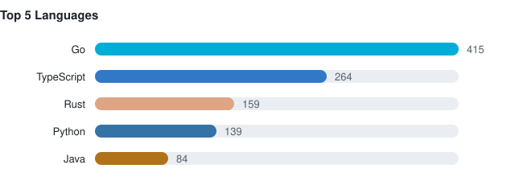

# compscie

My learning log: deep-dive notes on whatever I'm studying, plus LeetCode solutions.

## Notes

One folder per subject under [notes/](notes/), notes flat inside it. Start a topic with `make topic NAME=<slug>`, a note with `make note TOPIC=<topic> NOTE=<slug>`.

| Topic | Status | Notes | Started | Last note |
| --- | --- | ---: | --- | --- |
| [ClickHouse](notes/clickhouse/) | active | 2 | 2026-10-18 | 2026-10-24 |
| [Go](notes/go/) | active | 19 | 2026-08-23 | 2026-08-23 |

## LeetCode

**623 problems solved**, filed by difficulty - one folder each, with one file per language I solved it in. Full index: [leetcode/README.md](leetcode/README.md).

| | Count |
| --- | ---: |
| [Easy](leetcode/README.md#easy) | 284 |
| [Medium](leetcode/README.md#medium) | 306 |
| [Hard](leetcode/README.md#hard) | 24 |
| [Misc](leetcode/README.md#misc) | 9 |
| **Total** | **623** |

### Languages

