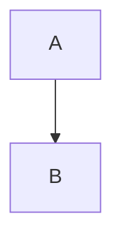

# Note A

> Summary line.

## Questions this answers

- What is `x`?

## Notes

### Same heading

### Same heading

See [B](b.md), [B details](./b.md#details), [the second](#same-heading-1), [lab](labs/run.sql), [labs](labs/), and [a site](https://example.com).

```go
func main() {}
```


